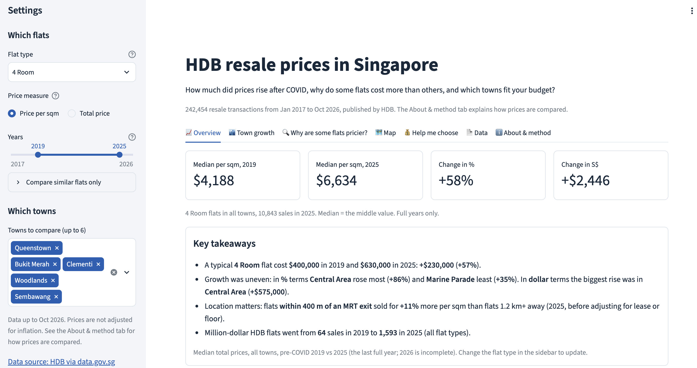
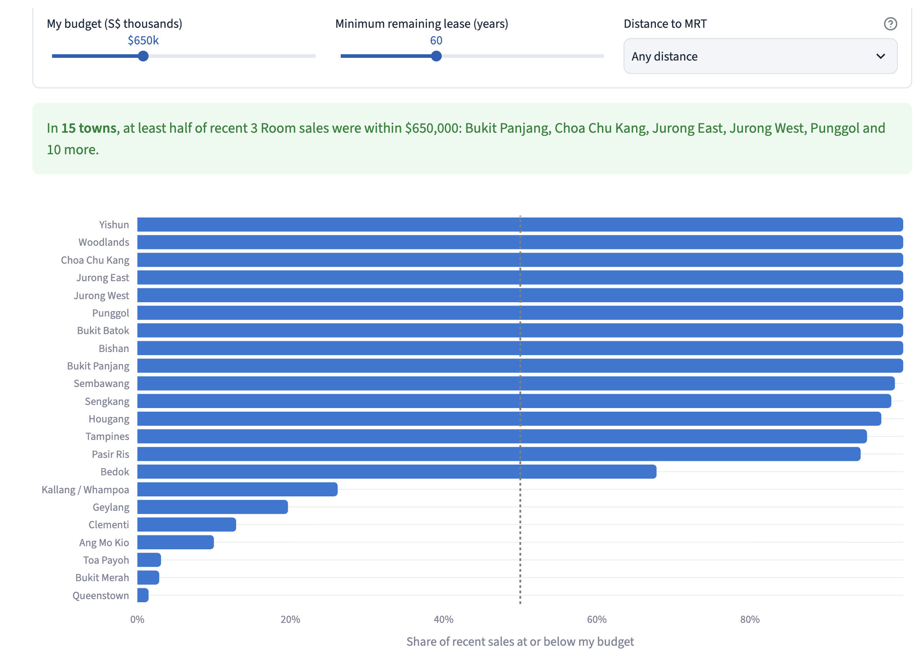
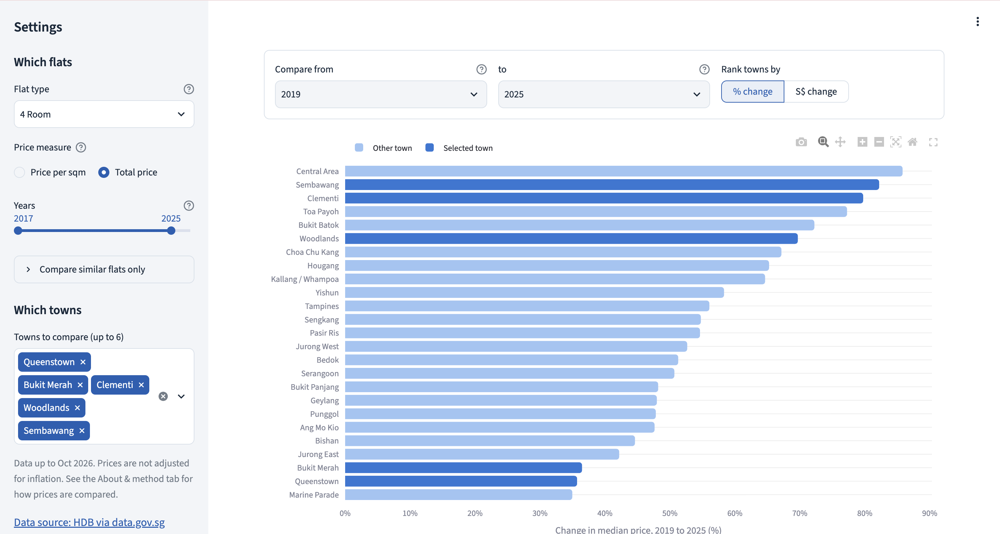
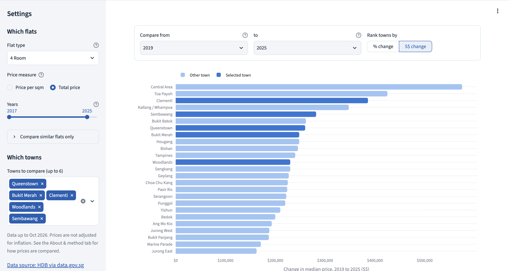
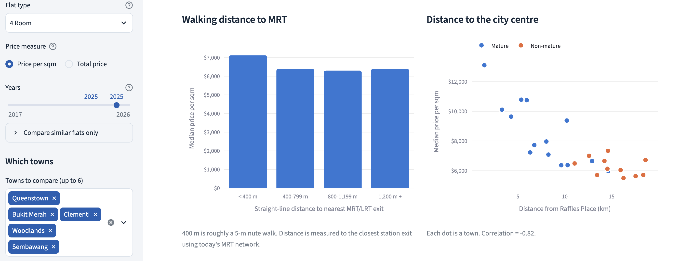
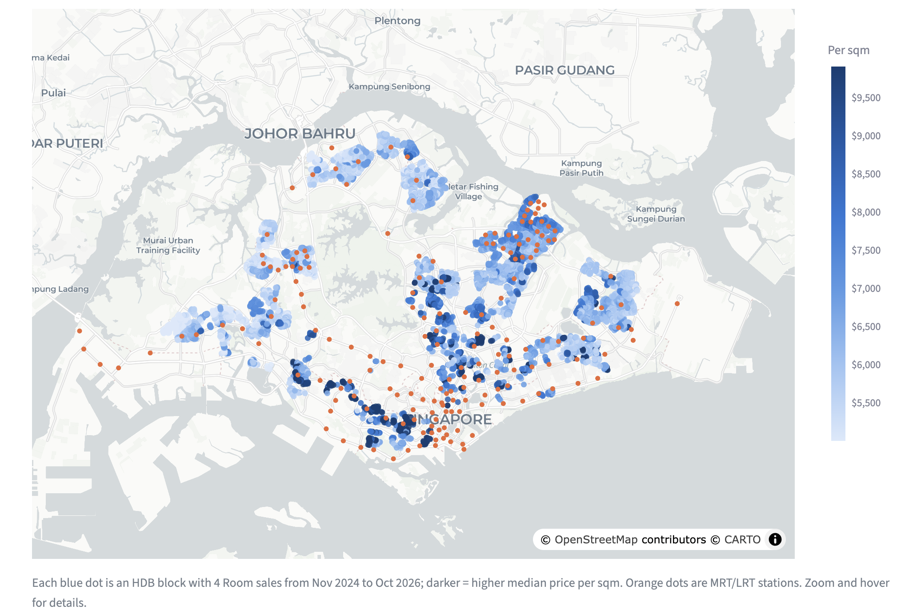
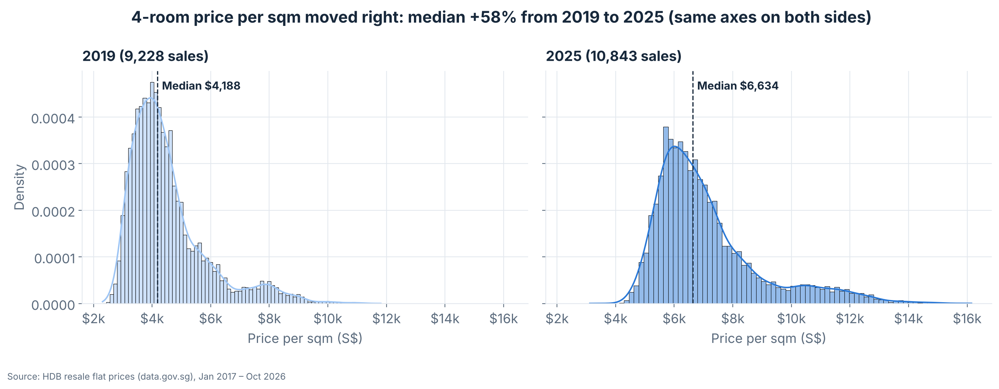
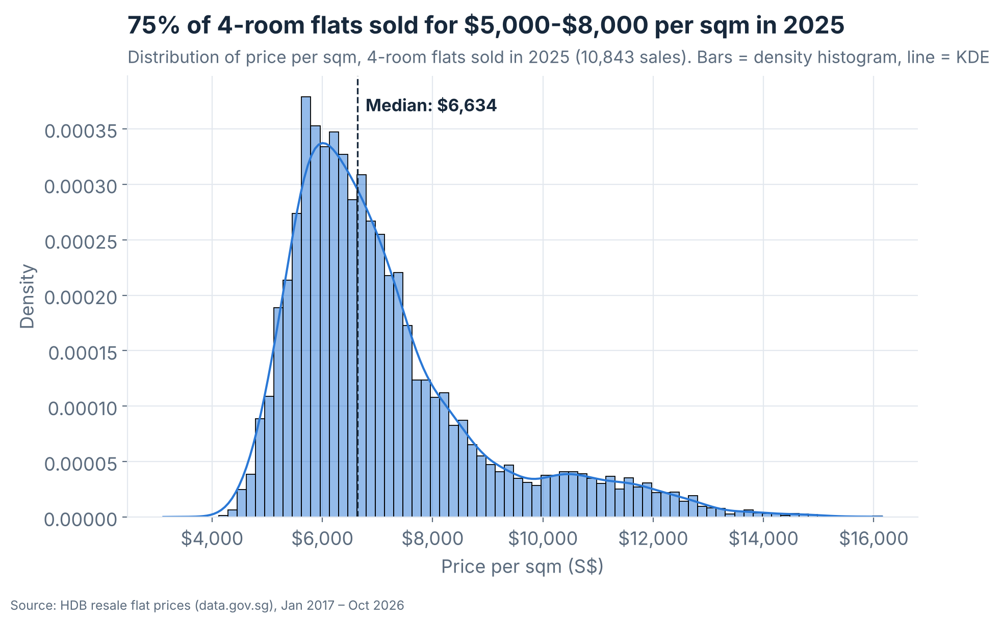
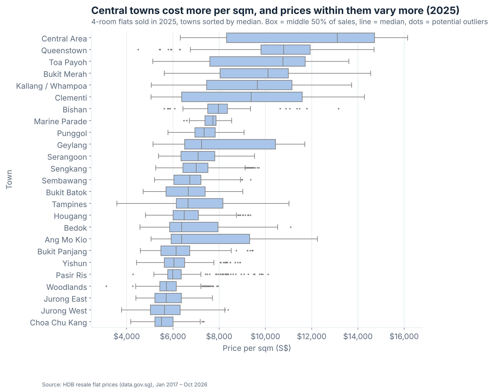
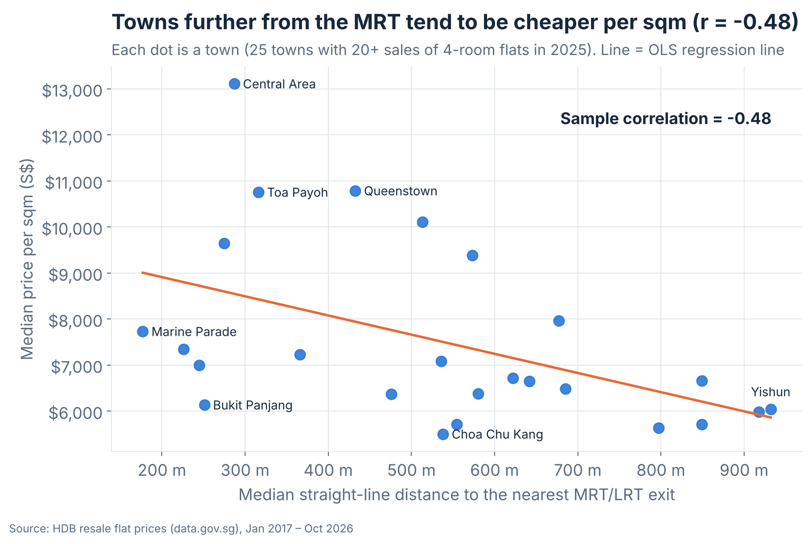

# HDB Resale Prices in Singapore (2017–2026)

**Which towns' HDB prices rose most after COVID, why are some flats and places worth more, and which towns fit a buyer's budget?**

DS608 Data Analytics for Economics · Group project · Singapore Management University, MSc in Data Science (MDSE)

**Group members:** Ma Tianjiao · Sun Jiayi · Deng Shenbojia

**Live dashboard:** _link will be added after deployment on Streamlit Community Cloud_

> This repository is our project report. It contains the code, data documentation, results and limitations.
> This project was completed as **MDSE group work**; see [CONTRIBUTIONS.md](CONTRIBUTIONS.md) for who did what.

---

## 1. Motivation

As international students, one of the first things we had to do in Singapore was find a place to rent, and rent depends a lot on how expensive an area is. Most Singapore residents live in HDB flats, and every resale transaction is published as open data. We also kept hearing that prices went up sharply after COVID, so we wanted to check this with real data and understand **what makes some flats and places more expensive than others**.

## 2. Research questions

1. **Growth:** Which towns saw the biggest increase in HDB resale prices after COVID (2019 vs. later years)?
2. **Drivers:** Why are some flats and locations more valuable? We look at the flat itself (remaining lease, floor level, size) and its location (mature estate, distance to the nearest MRT station, distance to the city centre).
3. **Decision support:** Can a dashboard help a buyer (or a renter estimating costs) find towns and blocks that fit their budget and needs?

Questions 2 and 3 were expanded after feedback from our TA on the proposal.

## 3. Data

| Dataset | Publisher | What we use it for | Licence |
|---|---|---|---|
| [Resale flat prices based on registration date from Jan-2017 onwards](https://data.gov.sg/datasets/d_8b84c4ee58e3cfc0ece0d773c8ca6abc/view) | HDB, via data.gov.sg | All resale transactions (~242,000 rows) | Singapore Open Data Licence |
| [LTA MRT Station Exit (GeoJSON)](https://data.gov.sg/datasets/d_b39d3a0871985372d7e1637193335da5/view) | LTA, via data.gov.sg | Location of every MRT/LRT exit | Singapore Open Data Licence |
| [3D city model of Singapore HDB buildings](https://github.com/ualsg/hdb3d-data) (v2019-08-25) | NUS Urban Analytics Lab (from HDB, OpenStreetMap and OneMap data) | Location of ~90% of HDB blocks | MIT |
| [OneMap Search API](https://www.onemap.gov.sg/apidocs/) | Singapore Land Authority | Location of the remaining (newer) blocks | OneMap Terms of Use |

Full details, column descriptions and known limitations: [data/DATA_SOURCES.md](data/DATA_SOURCES.md).

**What is (and is not) in this repository**

- `data/raw/hdb_resale_2017_onwards.csv` (24 MB) is **not tracked**; `src/download_data.py` downloads it.
- `data/raw/mrt_station_exits.csv` (small) **is tracked**.
- `data/external/hdb3d_block_centroids.csv` and `data/external/block_coordinates.csv` **are tracked**, because rebuilding them means a 90 MB download and a slow OneMap lookup.
- `data/processed/hdb_resale_clean.parquet` **is tracked** so that the online dashboard can run; it can be rebuilt with `src/wrangle.py`.

The HDB data are updated regularly. Our results use the version downloaded on **12 October 2026** (Jan 2017 – Oct 2026). Running the download again later will give slightly different numbers.

## 4. Repository structure

```
.
├── README.md                 Project report (this file)
├── AI_USAGE.md               How we used generative AI
├── CONTRIBUTIONS.md          Who did what
├── app.py                    Streamlit dashboard
├── .streamlit/config.toml    Dashboard colours and fonts (theme)
├── requirements.txt          Python packages
├── data/
│   ├── DATA_SOURCES.md       Data documentation
│   ├── raw/                  Original downloads (HDB CSV is not tracked)
│   ├── external/             Block coordinates from OneMap
│   └── processed/            Analysis-ready parquet file
├── src/
│   ├── download_data.py      1. Download HDB resale data
│   ├── check_data.py            Quick look at the raw data
│   ├── download_mrt.py       2. Download MRT exit locations
│   ├── building_coords.py    3a. Block locations from the NUS 3D HDB dataset
│   ├── geocode_blocks.py     3b. Remaining block locations (OneMap)
│   ├── wrangle.py            4. Clean data and add new variables
│   ├── make_tables.py        5. Summary tables used in this README
│   └── make_figures.py       6. Figures used in this README and the presentation
└── outputs/
    ├── tables/               Generated tables (CSV)
    ├── figures/              Figures (PNG) used in this README and the presentation
    └── presentation/         Presentation deck
```

## 5. How to reproduce

Requires Python 3.10+. Run all commands from the project root folder.

```bash
# 1. Create and activate a virtual environment
python -m venv .venv
source .venv/Scripts/activate      # Git Bash on Windows
# source .venv/bin/activate        # macOS / Linux

# 2. Install packages
pip install -r requirements.txt

# 3. Get the data and build the processed file
python src/download_data.py        # HDB resale data -> data/raw/
python src/download_mrt.py         # MRT exits -> data/raw/
python src/building_coords.py      # optional: block locations are already in data/external/
python src/geocode_blocks.py       # optional: same
python src/wrangle.py              # -> data/processed/hdb_resale_clean.parquet
python src/make_tables.py          # -> outputs/tables/
python src/make_figures.py         # -> outputs/figures/ (run after make_tables.py)

# 4. Start the dashboard
streamlit run app.py
```

`geocode_blocks.py` only looks up addresses that are not yet in `data/external/block_coordinates.csv`, so after a new HDB download it only needs to look up new blocks. OneMap limits searches without an account, so the script deliberately goes slowly (about 1 search per second). With a free OneMap API token saved in a `.env` file as `ONEMAP_TOKEN=...` it can run faster; `.env` is in `.gitignore` and is never uploaded.

## 6. Approach

**Cleaning (`src/wrangle.py`).** Convert `month` to a date; turn text such as `"61 years 04 months"` into 61.33 years; turn `"10 TO 12"` into floor 11; add price per square metre, flat age, mature/non-mature estate (HDB's official list of 15 mature estates), remaining-lease bands and a $1M+ flag.

**Location.** Each block address (block number + street) is matched to the centre of that building in the NUS 3D HDB dataset; blocks completed after mid-2019 are not in that dataset and are looked up with OneMap instead. We then compute the straight-line distance from each block to the **nearest MRT/LRT exit**, and to **Raffles Place** (as the centre of the CBD).

**Analysis.**
- We use **medians** rather than means, so a few very expensive flats do not pull results up.
- We compare **the same flat type** (mainly 4-room, the most common) to keep comparisons fair.
- **Comparing prices across years.** For each town and year we take the median **price per square metre** (or, optionally, the median total price). Each later year is compared with **2019**, the last full pre-COVID year:
  - **% change** = (median in year ÷ median in 2019 − 1) × 100
  - **S$ change** = median in year − median in 2019

  We report **both**, because ranking towns by % change does not identify the towns with the largest increases in dollars (see Findings).
- **Only full years are compared.** 2026 only covers January–October, so it is excluded from every year-to-year comparison (it appears only in the quarterly trend chart if the user selects it, and in the map (last 24 months) and the "Help me choose" tab (last 12 months)).
- Towns with fewer than 20 sales in either year are excluded from rankings.
- **Comparing like with like.** Besides flat type and price per sqm, the dashboard lets users restrict the **remaining lease** and **floor level** ("Compare similar flats only"), since both affect prices. The dashboard's **About & method** tab explains all of this.
- To separate overlapping factors (e.g. central flats are also older), we fit a **regression**:
  `log(price) ~ floor area + remaining lease + floor level + MRT distance + CBD distance + flat type + year`
  (OLS with robust standard errors). With log price, a coefficient *b* means about `100 × (exp(b) − 1)` % change in price.

## 7. Dashboard

| Tab | Question it answers |
|---|---|
| 📈 Overview | Key takeaways; % and S$ change since 2019, year by year; quarterly price trend in chosen towns; growth of $1M+ flats |
| 🏙️ Town growth | Which towns grew most since 2019, ranked by **% or S$ change**? Did cheaper towns catch up? |
| 🔍 Why are some flats pricier? | Lease, floor, mature estate, MRT distance, CBD distance, and the regression putting them together |
| 🗺️ Map | Where are flats most expensive per sqm? Where are MRT stations? |
| 💰 Help me choose | Which towns fit my budget, minimum lease and MRT distance? Which blocks sold within budget? |
| 📄 Data | Filtered data table and CSV download |
| ℹ️ About & method | Research questions, how prices are compared across years, how we keep comparisons fair, limitations, sources |

Sidebar filters: flat type, price measure (per sqm or total), years, towns, and **Compare similar flats only** (remaining lease and floor level).

**Screenshots** (taken from the running dashboard; the settings used are visible in the sidebar where shown):

| | |
|---|---|
|  **Overview** (years 2019–2025) |  **Help me choose** ($650k, 60+ years lease, 3-room) |
|  **Town growth by %** (total price, 2019→2025) |  **Town growth by S$** (same towns, different order) |
|  **Why are some flats pricier?** (2025 only) |  **Map** (4-room, last 24 months) |

## 8. Key findings

_Numbers come from `python src/make_tables.py` and charts from `python src/make_figures.py` (data up to Oct 2026). Unless we say otherwise, we look at **4-room flats**, the most common type, so that we compare similar homes._

### 1. Prices went up a lot after COVID, but not equally everywhere


- **The typical 4-room flat now costs much more.** The median price was **$400,000 in 2019** and **$630,000 in 2025**, so it went up by **$230,000 (+57%)**. The price per square metre went up by about the same amount (+58%, from $4,188 to $6,634).
- **The rise was slow at first, then fast, and has now slowed down.** Prices hardly moved before 2020. Compared with 2019, the price per sqm was +6% in 2020, +19% in 2021, +39% in 2023 and +58% in 2025 ([table](outputs/tables/yearly_change_vs_2019_4room.csv)). Since mid-2025 the quarterly median has stayed around $630,000.
- **Some towns went up much more than others** ([table](outputs/tables/town_growth_4room.csv)). The biggest % increases were in **Central Area (+86%)**, **Sembawang (+82%)**, **Clementi (+80%)** and **Toa Payoh (+77%)**. The smallest were in **Marine Parade (+35%)**, **Queenstown (+36%)** and **Bukit Merah (+36%)**.


- **Ranking towns by % and by dollars gives different answers.** The reason is the starting price. If two towns both go up by $260,000, the town that started cheaper shows a much bigger %. For example:
  - **Queenstown** started high ($728,000) and went up by $260,000. That is only **+36%** (24th out of 25 towns), but in dollars it is **7th**.
  - **Sembawang** started low ($343,000) and went up by $282,000. That is **+82%** (2nd), but in dollars it is only **5th**.
  - **Yishun** is 10th by % but 19th by dollars (+$210,000).

  For a buyer, the **dollar change** is what matters, because it is the extra money they need to pay or borrow. The **% change** is closer to an investment return. This is why the dashboard shows both.


- **Cheaper towns caught up a little**, for example Sembawang, Woodlands, Bukit Batok and Choa Chu Kang. But this pattern is weak, and part of it is because **newer flats started to be resold** in these towns, which pushes the median up (see *mix effects* in Limitations).
- **Million-dollar HDB flats are no longer rare.** There were **64** such sales in 2019 and **1,593** in 2025 ([table](outputs/tables/million_dollar_flats.csv)).


**Looking at the whole spread of prices, not just the median** (Seaborn charts, 4-room flats, price per sqm):

- **The whole range moved up, not only the middle.** In 2025 even the cheapest 5% of 4-room flats cost more per sqm (about $5,150) than the *median* flat in 2019 ($4,188).



- **Most flats are in a fairly narrow band, with a long tail of expensive ones.** In 2025, 75% of 4-room flats sold for $5,000-$8,000 per sqm. The long tail on the right is mostly flats in central towns.



- **Prices vary a lot inside some towns.** Central towns have the highest medians, but in towns such as Central Area, Clementi, Geylang and Ang Mo Kio the middle half of sales covers a very wide range. So a town's median alone can hide very different flats.



### 2. What makes a flat more expensive?

**First, one factor at a time: distance to the MRT** (4-room flats sold in 2025, [table](outputs/tables/mrt_band_4room_2025.csv)):

| Distance to nearest MRT/LRT exit | Median price per sqm | Median lease left | Sales |
|---|---|---|---|
| < 400 m | $7,120 | 79 years | 4,103 |
| 400–799 m | $6,392 | 72 years | 4,060 |
| 800–1,199 m | $6,300 | 73 years | 1,893 |
| 1,200 m + | $6,398 | 89 years | 787 |


- Flats less than 400 m from an MRT exit (about a 5-minute walk) cost about **11% more per sqm** than flats more than 1.2 km away. The simple reason is **convenience**: people pay more to save time on their daily trip to work or school.
- But the table also shows a surprise: the **farthest group is not the cheapest**. This is because many flats far from the MRT are **new**, with about 89 years of lease left, and a longer lease is worth more. So looking at one factor alone can mislead us. Other things change at the same time.

**The same pattern across towns.** Comparing towns (median distance to the MRT vs median price per sqm, 2025), towns further from the MRT tend to be cheaper, with a correlation of **r = -0.48**. This is only a moderate link: Bukit Panjang, for example, has flats very close to MRT/LRT stations (median about 250 m) but is one of the cheaper towns ($6,132 per sqm), probably because it is far from the city centre. This is another reason to look at all factors together.



**Second, all factors together.** To separate these effects, we used a **regression**. It compares flats that are the same in size, lease, floor, flat type, year and distance to the CBD, and then asks how much one factor changes the price (all flat types, 2017–2026, 242,454 sales, R² = 0.89, [table](outputs/tables/regression_effects.csv)):

| If a flat has… | Its price is about… | 95% CI |
|---|---|---|
| 10 sqm more floor area | +9.8% | 9.7% to 9.9% |
| 10 more years of lease left | +9.4% | 9.3% to 9.4% |
| 10 floors higher | +8.6% | 8.6% to 8.7% |
| 100 m further from the MRT | −0.6% | −0.64% to −0.61% |
| 1 km further from the CBD | −3.1% | −3.1% to −3.1% |


- **Size, lease and floor matter most.** Each one moves the price by about 9%.
- **Location still matters after we hold these equal.** A flat 1 km from the MRT sells for about **6% less** than the same flat right next to it, and a flat 10 km further from the CBD for about **27% less**.
- These numbers show that things **move together**, not that one **causes** the other (see Limitations).

The map shows the same story: flats are most expensive per sqm near the city centre, but some newer estates further out (for example in the north-east) are also expensive, because their flats have long leases.


### 3. Helping someone choose

The *Help me choose* tab turns these findings into a tool. The user sets a **budget**, a **minimum lease left** and a **maximum distance to the MRT**. The dashboard then shows which towns had most recent sales within that budget, and a shortlist of real blocks. For example, with **$650,000**, at least **60 years** of lease and any MRT distance, at least half of recent 3-room sales were within budget in **15 towns**, almost all outside the central area (for example Woodlands, Yishun, Punggol, Sengkang, Jurong West and Tampines).

## 9. Limitations

These limits mean our results should be read as a **guide**, not exact answers.

- **Resale prices are not rents.** We started from the question of how expensive an area is to live in, but our data are sale prices. They show which areas are expensive, not exactly what rent costs.
- **Prices are not adjusted for inflation.** Part of the +57% rise is general inflation, so the "real" increase is smaller.
- **Mix effects.** A town's median can go up just because **different flats are sold** that year (for example, new flats that reach the 5-year minimum stay and enter the resale market), not only because the same flats became more expensive. This can make some towns' growth look bigger than it is.
- **Distances are straight lines, using today's MRT map.** Real walking distance is longer. Also, stations that opened during 2017–2026 (for example on the Thomson–East Coast Line) are counted for older sales too, before they existed. Both make our MRT effect less precise.
- **Block locations come from two sources** (the NUS 3D HDB dataset for most blocks, OneMap for newer ones). Both are accurate to a few metres, which is small compared with our distance groups. Addresses that could not be matched are left out of the location charts and the regression.
- **Association, not cause.** Things we do not measure, such as nearby schools, malls, views or renovation, can affect both location and price. So we cannot say that moving a flat closer to the MRT would *cause* its price to rise by a fixed amount.
- **Only HDB resale flats.** New BTO flats and private property are not included.

## 10. AI usage and contributions

- Generative AI use is documented in [AI_USAGE.md](AI_USAGE.md).
- Individual contributions are documented in [CONTRIBUTIONS.md](CONTRIBUTIONS.md).

## 11. Acknowledgements

Data: Housing & Development Board and Land Transport Authority via data.gov.sg (Singapore Open Data Licence); Singapore Land Authority OneMap; NUS Urban Analytics Lab 3D HDB dataset (Biljecki 2020, MIT licence), which itself uses HDB, OpenStreetMap contributors and OneMap data. Built with pandas, statsmodels, Plotly Express and Streamlit for DS608 (Prof. Daniel Preve), SMU MDSE.
